# CrediYa — Sistema de gestión de créditos y cobranzas

**CrediYa** es una aplicación de consola desarrollada en Java que permite administrar el ciclo de vida de los créditos: registro de clientes, solicitudes, evaluación, generación de préstamos y cuotas, cobros, seguimiento de saldos y elaboración de reportes.

El proyecto busca centralizar operaciones que, si se gestionan manualmente o en herramientas separadas, dificultan el seguimiento de las obligaciones de los clientes. Para ello, ofrece accesos diferenciados según el rol y registra la información en una base de datos relacional MySQL.

## 1. Tecnologías utilizadas

| Tecnología | Uso en CrediYa |
|---|---|
| **Java 21** | Desarrollo de la aplicación de consola y lógica de negocio. |
| **MySQL** | Almacenamiento relacional de clientes, empleados, solicitudes, préstamos, cuotas y pagos. |
| **JDBC / MySQL Connector/J 8.3.0** | Comunicación entre Java y MySQL mediante consultas y operaciones transaccionales. |
| **Apache Maven** | Gestión de dependencias y compilación del proyecto (`pom.xml`). |
| **Apache NetBeans** | Entorno de desarrollo utilizado durante la construcción del sistema. |
| **MySQL Workbench** | Diseño del modelo entidad-relación y ejecución de los scripts SQL. |

## 2. Funcionalidades

### Funcionalidades generales

- Gestión de clientes y empleados, con acceso a operaciones según el rol.
- Inicio de sesión mediante documento de identidad; en el caso de los empleados, también se verifica el rol seleccionado y el estado de su cuenta.
- Registro, consulta y evaluación de solicitudes de crédito.
- Aprobación o rechazo de solicitudes por parte de un analista de créditos.
- Generación de préstamos y cronogramas de cuotas mediante **amortización francesa**.
- Consulta de préstamos, cuotas, vencimientos y saldos pendientes.
- Registro de cobros, incluidos **abonos parciales** y pagos completos.
- Historial de pagos y actualización automática de la puntuación crediticia.
- Consulta de la cartera de préstamos y generación de reportes.
- Exportación de reportes a archivos binarios mediante serialización de objetos Java.

### Funcionalidades por rol

| Rol | Operaciones disponibles |
|---|---|
| **Cliente** | Solicitar préstamos; consultar sus solicitudes, préstamos, cuotas e historial de pagos. |
| **Administrador general** | Gestionar empleados; consultar clientes, solicitudes, préstamos, cuotas y pagos; visualizar la cartera; generar y exportar reportes. |
| **Asesor de créditos** | Gestionar clientes, registrar solicitudes de crédito y consultar las solicitudes que ha tramitado. |
| **Analista de créditos** | Consultar solicitudes y evaluar las pendientes, aprobándolas o rechazándolas. |
| **Gestor de cobros** | Consultar clientes, préstamos y cuotas; revisar su historial de cobros; registrar pagos y abonos. |

La consulta de préstamos y cuotas para los roles autorizados incluye filtros para visualizar **todos los préstamos**, **los de un cliente específico** o **los vencidos**. Las operaciones que afectan información están restringidas según las responsabilidades de cada usuario.

## 3. Flujo y reglas de negocio

### Ciclo de un crédito

1. **Solicitud:** el cliente o un asesor registra el monto solicitado y la cantidad de cuotas.
2. **Evaluación:** el analista revisa la solicitud, el salario formal y el historial de puntos del cliente, y decide **manualmente** si la aprueba o la rechaza. No existe una aprobación automática basada en una fórmula de puntuación.
3. **Desembolso y cuotas:** cuando la solicitud se aprueba, el sistema crea el préstamo y su cronograma de pagos.
4. **Cobranza:** el gestor registra pagos contra las cuotas pendientes y el saldo del préstamo se actualiza.
5. **Seguimiento:** se consultan cuotas, pagos, vencimientos, puntuaciones e indicadores de cartera.

### Principales reglas

- **Un préstamo sin liquidar por cliente:** un cliente no puede obtener un nuevo préstamo mientras tenga otro **activo o vencido**. Puede solicitar otro una vez que el anterior figure como **pagado**.
- **Amortización francesa:** las cuotas se calculan considerando capital e intereses; se utiliza una tasa de interés del **2 % mensual** en la implementación del proyecto y `BigDecimal` para manejar los importes monetarios.
- **Orden de cobro:** los pagos se aplican a la **cuota impaga más antigua** del préstamo.
- **Abonos parciales:** una cuota puede recibir varios pagos. Solo pasa a estado **pagada** cuando la suma de los pagos confirmados cubre su monto completo.
- **Control de importes:** los abonos no pueden superar el saldo pendiente de la cuota ni el saldo restante del préstamo.
- **Registro de pagos:** los cobros se realizan por el gestor de cobros y quedan confirmados al registrarse. Los métodos admitidos son **efectivo, tarjeta y Yappy**.
- **Puntuación crediticia:** al completar una cuota a tiempo se suman **3 puntos positivos**; si se completa con retraso, se suman **3 puntos negativos por cada día de mora**. Los abonos que todavía no completan una cuota no generan puntos.
- **Vencimientos:** una cuota impaga puede pasar a **vencida** al sobrepasar su fecha límite. El préstamo se marca como **vencido** cuando ha pasado su fecha de vencimiento final y aún mantiene saldo.
- **Integridad:** las operaciones críticas de aprobación y pago emplean transacciones para mantener coherentes los registros relacionados.

## 4. Arquitectura y estructura del proyecto

CrediYa sigue una organización inspirada en el patrón **Modelo–Vista–Controlador (MVC)**, complementada con una capa **DAO (Data Access Object)** para la persistencia. Las vistas se encargan de la interacción por consola; los controladores coordinan el flujo y las reglas de negocio; el modelo representa las entidades; y los DAO consultan y modifican la base de datos por medio de JDBC.

**Responsabilidad de los paquetes:**

| Paquete | Responsabilidad |
|---|---|
| `controller` y `controller.panels` | Coordinación de casos de uso, autenticación y navegación de los distintos roles. |
| `view` y `view.panel` | Menús, lectura de opciones y presentación de resultados en consola. |
| `model.entity` | Clases que representan clientes, empleados, solicitudes, préstamos, cuotas, pagos y reportes. |
| `model.enums` | Estados, roles y métodos de pago definidos mediante enumeraciones. |
| `dao` | Acceso y persistencia de datos mediante SQL y JDBC. |
| `database` | Configuración y apertura de conexiones a MySQL. |
| `strategy` | Contrato e implementación de la estrategia de amortización francesa. |
| `utils` | Validación de entradas y funciones auxiliares para las cuotas. |
| `exception` | Excepción propia utilizada para manejar errores de acceso a datos. |

### Árbol de directorios

```text
proyecto_creditos/
├── src/
│   └── main/
│       └── java/
│           ├── com/valentina_corner/proyecto_creditos/
│           │   └── ProyectoCreditos.java
│           ├── controller/
│           │   ├── panels/
│           │   │   ├── PanelAdmin.java
│           │   │   ├── PanelAnalista.java
│           │   │   ├── PanelAsesor.java
│           │   │   ├── PanelCliente.java
│           │   │   └── PanelCobros.java
│           │   ├── ControllerCliente.java
│           │   ├── ControllerEmpleado.java
│           │   ├── ControllerGeneral.java
│           │   ├── ControllerPago.java
│           │   ├── ControllerPrestamo.java
│           │   ├── ControllerReporte.java
│           │   └── ControllerSolicitud.java
│           ├── dao/
│           │   ├── ClienteDAO.java
│           │   ├── CuotaDAO.java
│           │   ├── EmpleadoDAO.java
│           │   ├── PagoDAO.java
│           │   ├── PrestamoDAO.java
│           │   └── SolicitudDAO.java
│           ├── database/
│           │   └── Conexion.java
│           ├── exception/
│           │   └── DAOException.java
│           ├── model/
│           │   ├── entity/
│           │   │   ├── Cliente.java
│           │   │   ├── Cuota.java
│           │   │   ├── Empleado.java
│           │   │   ├── Pago.java
│           │   │   ├── Persona.java
│           │   │   ├── Prestamo.java
│           │   │   ├── ReporteGuardado.java
│           │   │   ├── Solicitud.java
│           │   │   └── SolicitudEvaluacion.java
│           │   └── enums/
│           │       ├── EstadoCuota.java
│           │       ├── EstadoEmpleado.java
│           │       ├── EstadoPago.java
│           │       ├── EstadoPrestamo.java
│           │       ├── EstadoSolicitud.java
│           │       ├── MetodoPago.java
│           │       └── Rol.java
│           ├── strategy/
│           │   ├── AmortizacionFrancesa.java
│           │   └── EstrategiaAmortizacion.java
│           ├── utils/
│           │   ├── CalculadoraCuotas.java
│           │   └── Validacion.java
│           └── view/
│               ├── panel/
│               │   ├── MenuPanelAdmin.java
│               │   ├── MenuPanelAnalista.java
│               │   ├── MenuPanelAsesor.java
│               │   ├── MenuPanelCliente.java
│               │   └── MenuPanelCobros.java
│               ├── Mensajes.java
│               ├── MenuGeneral.java
│               ├── VistaCliente.java
│               ├── VistaEmpleado.java
│               ├── VistaPago.java
│               ├── VistaPrestamo.java
│               ├── VistaReporte.java
│               └── VistaSolicitud.java
├── docs/
│   ├── DatosPruebaSQL.txt
│   ├── ScriptSQLEntidades.txt
│   └── diagrama_ER.png
├── pruebas/                     # Capturas de funcionamiento
│   └── ...
├── pom.xml
├── nbactions.xml
└── .gitignore
```

> La carpeta `pruebas/` corresponde a las capturas de la demostración y debe incluirse en el repositorio para que se visualicen en GitHub. Se omiten las carpetas generadas automáticamente, como `target/`.

### Modelo entidad-relación

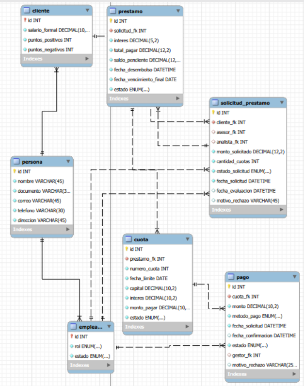

El modelo relacional incluye las tablas `persona`, `cliente`, `empleado`, `solicitud_prestamo`, `prestamo`, `cuota` y `pago`, vinculadas mediante claves primarias y foráneas.

## 5. Conceptos y principios de desarrollo

- **Programación orientada a objetos:** uso de encapsulamiento, abstracción y herencia; por ejemplo, `Cliente` y `Empleado` extienden la clase abstracta `Persona`.
- **Principios SOLID:** se aplican criterios de separación de responsabilidades y dependencia de abstracciones, especialmente en la división entre vistas, controladores, DAO y la interfaz de estrategia. Esto no implica que todas las clases constituyan una implementación estricta de los cinco principios.
- **Patrón MVC:** organización de las responsabilidades de interfaz, control y modelo para facilitar el mantenimiento.
- **Patrón DAO:** separación de las consultas SQL respecto del código de interacción con el usuario.
- **Patrón Strategy:** `EstrategiaAmortizacion` define el contrato y `AmortizacionFrancesa` implementa el cálculo de cuotas.
- **JDBC y transacciones:** utilización de `Connection`, `PreparedStatement`, `ResultSet`, `commit` y `rollback` en operaciones que requieren consistencia.
- **Lambda y Stream API:** filtrado y procesamiento de préstamos y clientes para construir los reportes del sistema.
- **Serialización:** `ReporteGuardado` implementa `Serializable` y el reporte se exporta mediante `ObjectOutputStream` a un archivo `.dat`.
- **Precisión monetaria:** `BigDecimal` se usa para cálculos y operaciones con cantidades de dinero.

## 6. Instalación y configuración

### Requisitos previos

- **JDK 21**.
- **MySQL Server** en ejecución.
- **Apache NetBeans** con soporte para proyectos Maven, o un entorno compatible con Java y Maven.
- **MySQL Workbench** (recomendado para importar los scripts, aunque no es indispensable para ejecutar la aplicación).
- **Git** para clonar el repositorio.

El controlador JDBC de MySQL ya está declarado como dependencia en el archivo `pom.xml`, por lo que Maven puede descargarlo automáticamente.

### Paso 1. Clonar el repositorio

```bash
git clone https://github.com/valentinarincon39777-coder/java-credit-and-collections-management.git
cd java-credit-and-collections-management
```

### Paso 2. Crear la base de datos y las tablas

1. Inicia **MySQL Server** y abre MySQL Workbench.
2. Abre el archivo [`docs/ScriptSQLEntidades.txt`](docs/ScriptSQLEntidades.txt) como script SQL.
3. Ejecuta **todo su contenido**. El script crea el esquema `CrediYa` y las tablas relacionadas.

> Aunque el archivo tiene extensión `.txt`, contiene instrucciones SQL. Puede abrirse y ejecutarse desde el editor SQL de Workbench. No es necesario copiar cada sentencia por separado.

### Paso 3. Cargar los datos de prueba

1. Abre [`docs/DatosPruebaSQL.txt`](docs/DatosPruebaSQL.txt) en MySQL Workbench.
2. Ejecuta su contenido **después de crear las tablas**, sobre una base de datos recién creada y sin registros de prueba previos.
3. Comprueba que se insertaron los cuatro empleados y los dos clientes.

Los datos de prueba permiten acceder directamente a los distintos roles, sin tener que registrar usuarios manualmente antes de comenzar.

### Paso 4. Configurar la conexión con MySQL

Abre [`src/main/java/database/Conexion.java`](src/main/java/database/Conexion.java) y ajusta los datos de conexión a tu instalación local:

- **Servidor y puerto:** normalmente `localhost:3306`.
- **Esquema:** `crediya` / `CrediYa`, según el nombre creado por el script y la configuración de MySQL.
- **Usuario:** tu usuario local de MySQL (por ejemplo, `root`).
- **Contraseña:** la contraseña correspondiente a ese usuario.

La aplicación necesita que esos datos coincidan con los de MySQL Server. No compartas contraseñas reales en repositorios públicos.

### Paso 5. Abrir el proyecto

1. Abre NetBeans y selecciona **File > Open Project**.
2. Selecciona la carpeta que contiene el archivo `pom.xml`.
3. Deja que Maven resuelva las dependencias.
4. Comprueba que MySQL Server se encuentra activo.

## 7. Ejecución y usuarios de prueba

Ejecuta el proyecto desde NetBeans mediante **Run Project** o inicia la clase principal:

`com.valentina_corner.proyecto_creditos.ProyectoCreditos`

También puedes ejecutarlo con Maven desde la carpeta del proyecto:

```bash
mvn compile exec:java -Dexec.mainClass=com.valentina_corner.proyecto_creditos.ProyectoCreditos
```

En el menú principal, selecciona el acceso de **cliente** o **empleado**. Los clientes ingresan su documento; los empleados seleccionan primero el rol correspondiente y luego su documento.

### Cuentas de prueba

| Tipo | Nombre | Rol | Documento |
|---|---|---|---|
| Empleado | Carlos Mendoza | Administrador general | `8-111` |
| Empleada | Laura Gomez | Asesora de créditos | `8-222` |
| Empleado | Andres Rodriguez | Analista de créditos | `8-333` |
| Empleada | Sofia Martinez | Gestora de cobros | `8-444` |
| Cliente | Valentina Perez | Cliente | `8-555` |
| Cliente | Daniel Castillo | Cliente | `8-666` |

Los empleados se encuentran inicialmente **activos** y los clientes comienzan con **cero puntos positivos y negativos**. Los salarios formales de los clientes son de **1,800.00** y **1,200.00**, respectivamente, según el script de prueba.

**Importante:** los datos de prueba no representan personas reales. El inicio de sesión de esta versión académica se basa en el documento de identidad y no incluye autenticación mediante contraseña.

## 8. Pruebas y evidencias

Se realizaron pruebas manuales de los principales flujos de la aplicación. Las capturas siguientes ilustran los resultados obtenidos desde los distintos roles, así como las operaciones de crédito, cobranza y reportes.

| N.º | Evidencia | Qué demuestra |
|---|---|---|
| 1 | Inicio de sesión de empleado | Selección y acceso al panel según el rol. |
| 2 | Inicio de sesión de cliente | Acceso del cliente mediante su documento. |
| 3 | CRUD de clientes | Gestión de datos de clientes desde el rol autorizado. |
| 4 | Solicitud de préstamo | Registro de una solicitud de crédito. |
| 5 | Aprobación de solicitud | Evaluación del analista y aprobación del crédito. |
| 6 | Préstamos y cuotas | Consulta del préstamo generado y su cronograma. |
| 7 | Primer abono parcial | Registro de un pago parcial a una cuota. |
| 8 | Segundo abono parcial | Seguimiento de abonos sucesivos y saldo restante. |
| 9 | Pago completo | Liquidación de la cuota mediante pagos. |
| 10 | Historial de pagos | Consulta de pagos registrados. |
| 11 | Cartera | Visualización de los indicadores de la cartera crediticia. |
| 12 | Reportes | Generación y consulta del reporte general. |
| 13 | Exportación serializada | Exportación del reporte a un archivo `.dat`. |

<details>
<summary><strong>1. Inicio de sesión de empleado</strong></summary>

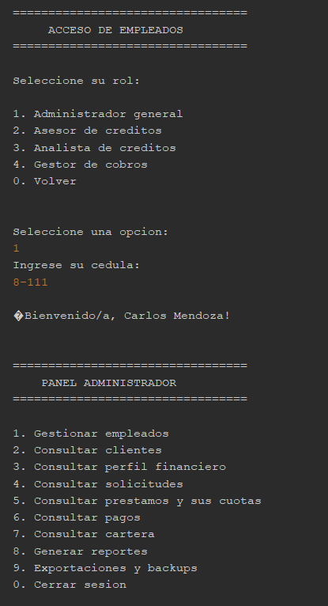

</details>

<details>
<summary><strong>2. Inicio de sesión de cliente</strong></summary>

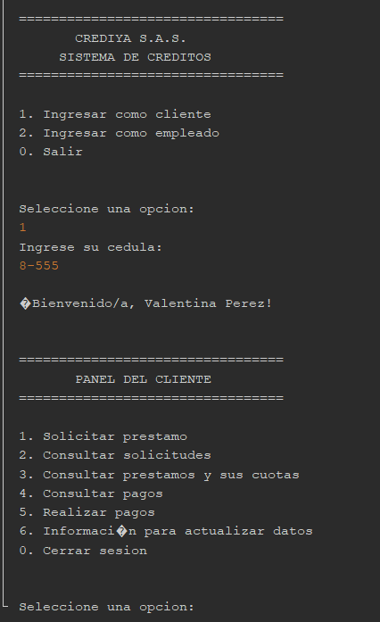

</details>

<details>
<summary><strong>3. Gestión de clientes (CRUD)</strong></summary>

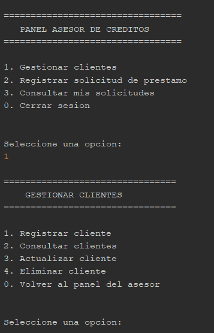

</details>

<details>
<summary><strong>4. Registro de solicitud de préstamo</strong></summary>

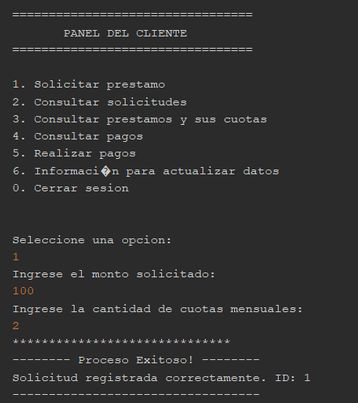

</details>

<details>
<summary><strong>5. Evaluación y aprobación de solicitud</strong></summary>

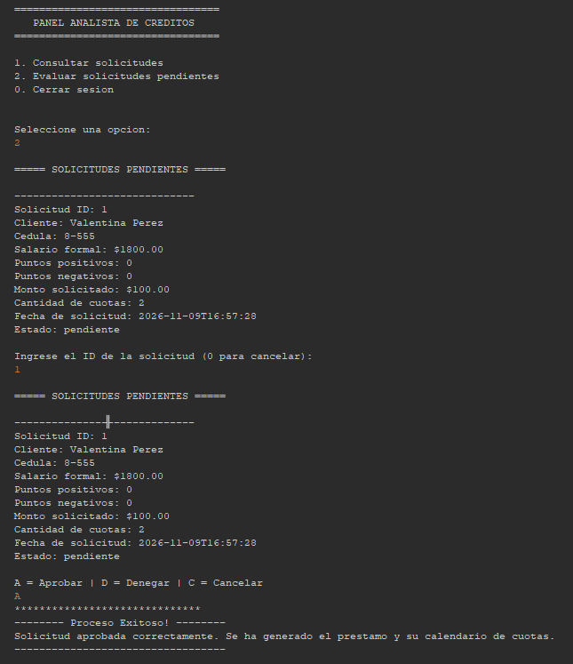

</details>

<details>
<summary><strong>6. Consulta de préstamos y cuotas</strong></summary>

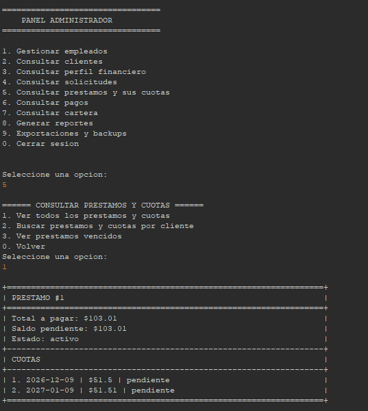

</details>

<details>
<summary><strong>7. Primer abono parcial a una cuota</strong></summary>

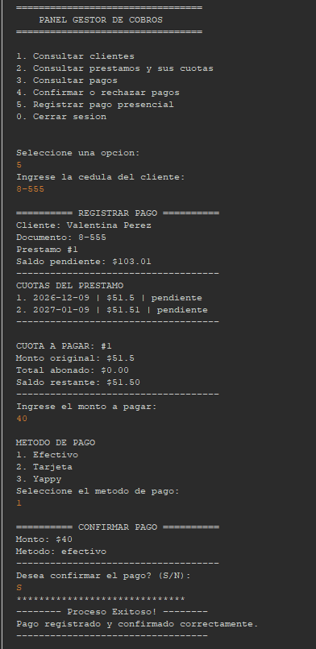

</details>

<details>
<summary><strong>8. Segundo abono parcial a una cuota</strong></summary>

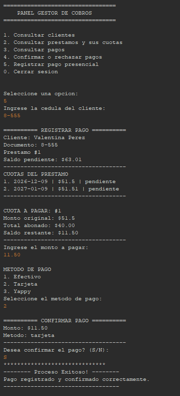

</details>

<details>
<summary><strong>9. Pago completo de una cuota</strong></summary>

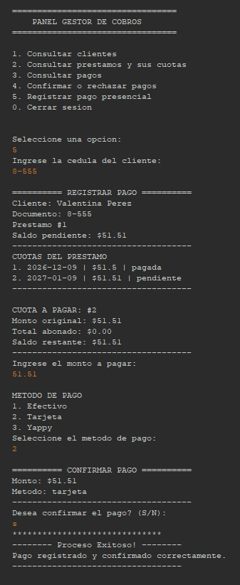

</details>

<details>
<summary><strong>10. Historial de pagos</strong></summary>

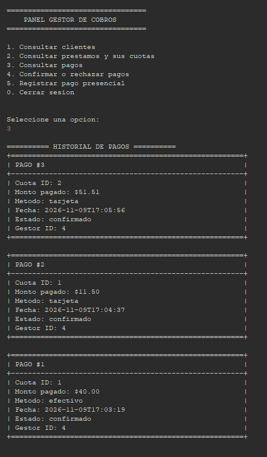

</details>

<details>
<summary><strong>11. Consulta de cartera</strong></summary>

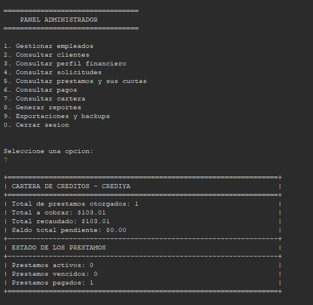

</details>

<details>
<summary><strong>12. Generación de reportes</strong></summary>

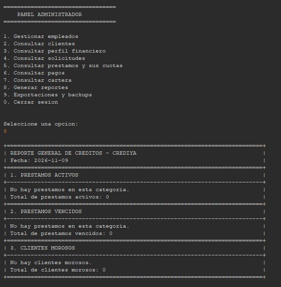

</details>

<details>
<summary><strong>13. Exportación de reporte serializado</strong></summary>

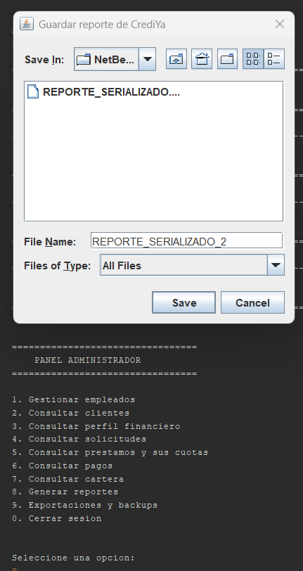

</details>

> **Sobre la exportación:** el archivo `.dat` contiene un objeto Java serializado, no un documento de texto ni una copia restaurable de toda la base de datos. Para visualizar su contenido se requiere una lectura mediante deserialización compatible.

## 9. Autoría

**Valentina Rincon Mayorga**  
Desarrollo de CrediYa — Sistema de gestión de créditos y cobranzas.
